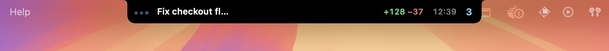
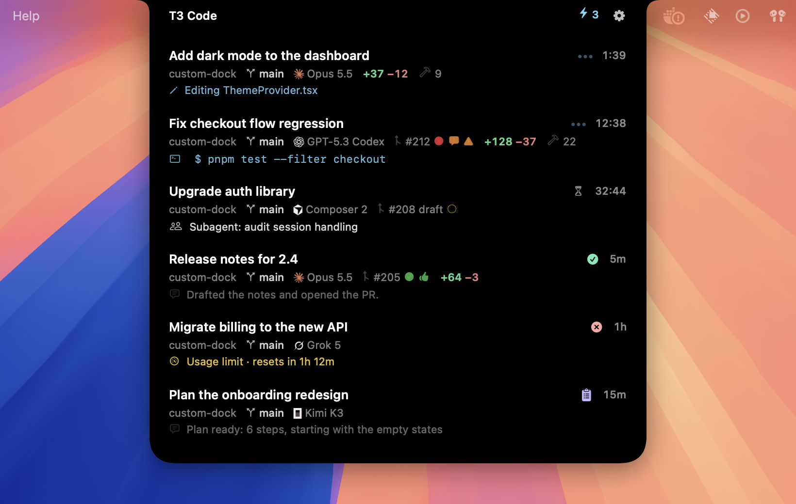
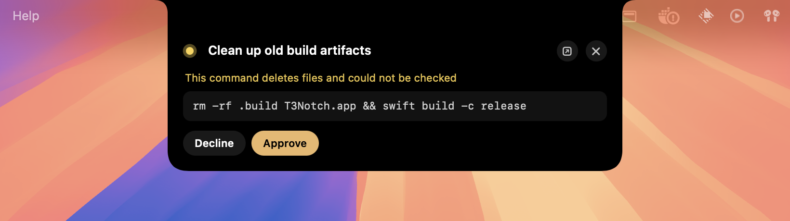
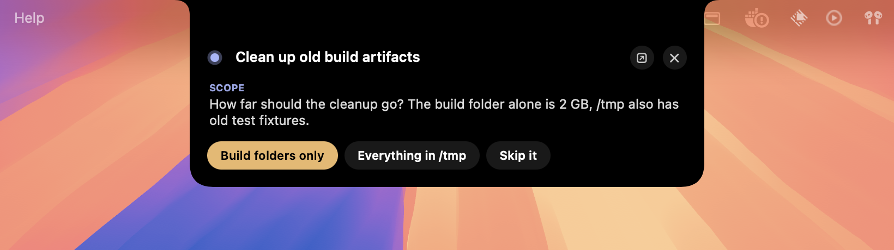
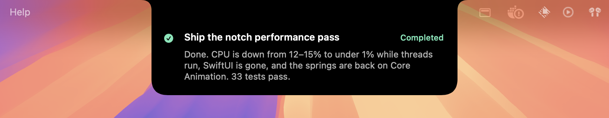
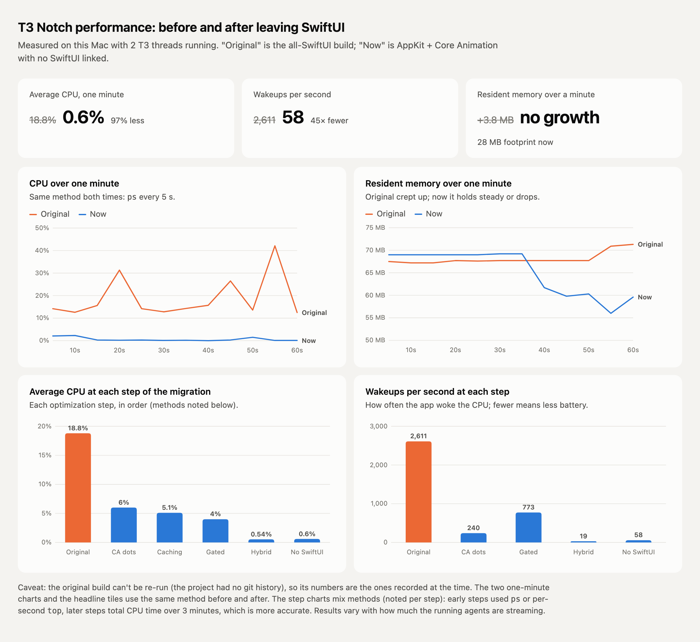

# t3code-notch

A Dynamic Island–style notch for [T3 Code](https://github.com/t3tools/t3code) on macOS. See what your agents are doing, answer them, and stop them, without leaving the app you're in.



Hover it (or press **⌘⇧Space**) for the full list:



When an agent needs you, answer right from the notch:

| Approvals | Questions |
|---|---|
|  |  |

And when a run finishes, its final message drops down for a few seconds:



## Performance

It sits on screen all day, so it has to cost close to nothing. The first version was built in SwiftUI and used **~19% CPU** while agents ran. Rebuilding it on AppKit + Core Animation brought that under **1%**.

<picture>
  <source media="(prefers-color-scheme: dark)" srcset="docs/screenshots/performance-dark.png">
  
</picture>

| | All SwiftUI (before) | AppKit + Core Animation (now) |
|---|---|---|
| Average CPU over a minute, 2 agents running | 18.8% (spikes to 42%) | **0.6%** |
| Wakeups per second | 2,611 | **58** |
| Memory over a minute | grew +3.8 MB | **no growth** (28 MB footprint) |
| SwiftUI linked | yes | **no** |

What made the difference, in order:

| Step | Avg CPU | Wakeups/s | How it was measured |
|---|---|---|---|
| Original: all SwiftUI | 18.8% | 2,611 | `ps` every 5 s, 60 s |
| Animated dots on Core Animation, audio engine stops between clicks, updates throttled | 6.0% | 240 | `ps` every 5 s, 60 s |
| Status computed once per change, shared date parsers | 5.1% | | `top` per second, 90 s |
| Collapsed notch redraws only when something visible changes | 4.0% | 773 | CPU time over 3 min |
| Compact bar in AppKit, SwiftUI only while open | 0.54% | 19 | CPU time over 3 min |
| **Everything AppKit + Core Animation, no SwiftUI** | **0.6%** | **58** | `ps` every 5 s, 60 s |

Why it worked: SwiftUI re-lays out the whole view tree on every animation frame and every state change. For an always-visible, always-animating widget fed several updates a second, that was ~95% of the CPU. With Core Animation the window server runs the springs, slides and rolling digits, so the app does no work per frame.

The original build can't be re-run, so its numbers are the ones recorded at the time. The before/after table uses the same method for both columns; the step table notes its method per row. The [interactive version](docs/performance.html) has hover details.

## Features

- **Live compact bar:** the working thread's title, what it's doing (command, file edit, thinking), `+added −removed` lines and a timer. It rotates through working threads with a spring slide; long commands scroll instead of being cut off.
- **Pixel logos:** each provider's logo as pixel art in its own colors (Claude, Codex, Cursor, Grok, Meta, opencode, Pi). While a thread works, a lit head sweeps around the logo (opencode's "Soft Radar" loader); while it waits on background work, a soft band drifts down and up it.
- **Motion:** opening the notch, the bar's title flies into its row (and back on close). A finished run springs open with a checkmark drawing itself and a green flash along the edge; "needs you" gives a small wiggle. The edge glows in the lead status color and a light sweeps along the bottom while agents run.
- **Split island:** something needs you while other threads work and you put its card away? It moves to its own little bubble beside the notch; click it to answer.
- **T3's own statuses:** Working, Connecting, Waiting, Pending Approval, Awaiting Input, Failed, Plan Ready, Completed. The logic is ported from T3's sidebar and covered by tests.
- **Act without switching apps:** approve or deny, tap an answer, reply or steer a running agent, or stop a run (two clicks).
- **Live terminal:** hover a running command to watch its last lines stream in.
- **At a glance:** branch, model with the provider's logo, PR number with CI checks / review / conflict markers, and a usage-limit countdown.
- **Keyboard:** ⌘⇧Space opens it; ↑↓ select, ⏎ open, R reply, A/D approve/deny, 1–9 answer, Esc close.
- **Matches your T3 theme:** background, buttons, cards, the glow and the Working color follow T3's palette (T3 Chat, Grove, Ocean, Ember, Iris) live. Around a camera notch the top stays black and fades into the theme color. Pick one yourself under Theme in the menu.
- **Cozy sounds:** a soft chime when a run finishes, a deep wooden knock-knock when an agent needs you.
- **Private by default:** invisible to screen sharing, recordings and screenshots (toggle in the menu).
- **Light on resources:** AppKit + Core Animation, no SwiftUI. Under 1% CPU while agents run, and no memory growth (see [Performance](#performance)).
- **On your iPhone, anywhere:** a Live Activity on the Lock Screen (and Apple Watch, CarPlay, StandBy) that the Mac pushes straight to Apple, so it updates in real time over cellular too. See [iPhone Live Activity](#iphone-live-activity).

## Requirements

- macOS 14 or later (built and tested on macOS 26)
- [T3 Code](https://github.com/t3tools/t3code) desktop app, running
- Xcode command-line tools (Swift 5.9+)

## Build and run

```sh
./build.sh          # builds T3Notch.app (signs with your "Apple Development" identity if present, else ad-hoc)
open T3Notch.app
swift test          # status, wire-format and diff-count tests
```

The menu-bar icon has the settings: which display(s) to show it on, sounds, screen-sharing visibility, theme, model display, and Launch at Login.

## iPhone Live Activity

Your threads on the iPhone's Lock Screen, updated in real time wherever you are, not just on your home Wi-Fi. The notch already sees every state change as it happens and pushes it straight to Apple's push service (APNs) from your Mac. There's no server in between.

- **What it shows:** the running threads with their pixel logos, live timers (counted on the phone), `+/−` lines rolling to new values, PR number with CI checks, and a card for what just happened, with the final message or the question.
- **Sounds:** the notch's own. A chime when a run finishes, the wooden knock-knock when an agent needs you, a lower knock when one fails. The screen lights up for those, and only those.
- **Tap:** opens that thread in T3 Code.
- **Lifecycle:** it starts by itself when a thread starts working, ends 5 minutes after everything is idle, and restarts before iOS's 8-hour limit.

How it works: the iPhone app pairs once over the local network and hands the Mac its push-to-start token. The Mac starts the Live Activity remotely, subscribed to a broadcast channel (iOS 18+), and sends every update to that channel. APNs allows a channel about 4 updates a minute, so finishes and "needs you" go out at once and smaller changes are batched.

### Setup

You need a paid Apple Developer account and Xcode.

1. **Build and install the iPhone app:** with the phone connected, run `cd Phone && T3NOTCH_TEAM_ID=<your team id> xcodegen`, then open `T3NotchPhone.xcodeproj` and run it (or build with `xcodebuild … -allowProvisioningUpdates`). The bundle ids are `dev.custom-dock.t3notch.phone` (+ `.live`); change them in `Phone/project.yml` and `LiveActivityProtocol.phoneBundleId` if they're taken.
2. **Turn on broadcast:** in Certificates, IDs & Profiles → Identifiers → the phone app → Push Notifications, tick **Broadcast Capability**.
3. **Create a push key:** Keys → **+** → Apple Push Notifications service (Sandbox & Production, team scoped). Download the `.p8`.
4. **On the Mac:** menu → **iPhone Live Activity → Set Push Key…**, pick the `.p8` and enter your team id. It's copied to `~/Library/Application Support/T3Notch/` with owner-only permissions.
5. **Pair:** **Pair iPhone…** shows a 6-digit code; enter it in the phone app (same Wi-Fi, this once).

If the Live Activity ever goes missing while threads run (swiped away, or ended by an app update), use **Restart Live Activity** in the same menu.

## How it connects

- Finds the local T3 server through `~/.t3/userdata/server-runtime.json`, re-read on every reconnect, so a port change or restart is picked up automatically.
- On first launch it creates its own bearer token with T3's CLI (`~/.t3/bin/t3 auth session issue`, scopes `orchestration:read` + `orchestration:operate`, 30 days, label "T3 Notch"). The token is stored in `~/Library/Application Support/T3Notch/` with owner-only permissions, and re-issued if the server rejects it.
- Streams the thread list (`orchestration.subscribeShell`) and, for the visible threads only, their activity (`orchestration.subscribeThread`) over T3's WebSocket RPC (orchestration protocol 2). A newer protocol shows "Needs an update".
- Live `+/−` counts mid-run read only the patch of each file edit from T3's local database, read-only, because the server doesn't send it. The exact numbers arrive with the run's checkpoint either way.

## Development

| Variable | Effect |
|---|---|
| `T3NOTCH_DEMO=approval\|question\|finished\|list\|split` | fake threads for layouts and screenshots |
| `T3NOTCH_ALLOW_CAPTURE=1` | let screenshots include the notch for this launch |
| `T3NOTCH_FORCE_EXPANDED=1` | keep the list open |
| `T3NOTCH_RUNTIME_FILE=path` | read the server address from another file |

- `scripts/screenshots.sh` regenerates `docs/screenshots/` (run it from an empty desktop).
- `scripts/extract-logos.py /path/to/t3code` refreshes the provider logos from T3 Code's sources.
- `scripts/make-icon.swift` regenerates the app icon.

The working animation is opencode's "Soft Radar" spinner ([opencode](https://github.com/sst/opencode), MIT, © opencode; license in `LICENSES/opencode.txt`), run over pixel-art versions of the provider logos. The finish sound is the "classic" sound from [Hex](https://github.com/anomalyco/hex) (MIT, © Christopher Langton; license in `Resources/Sounds/LICENSE-hex`). Provider logos are the ones T3 Code ships and belong to their respective owners. This project isn't affiliated with T3 Tools.
