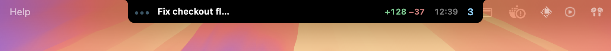
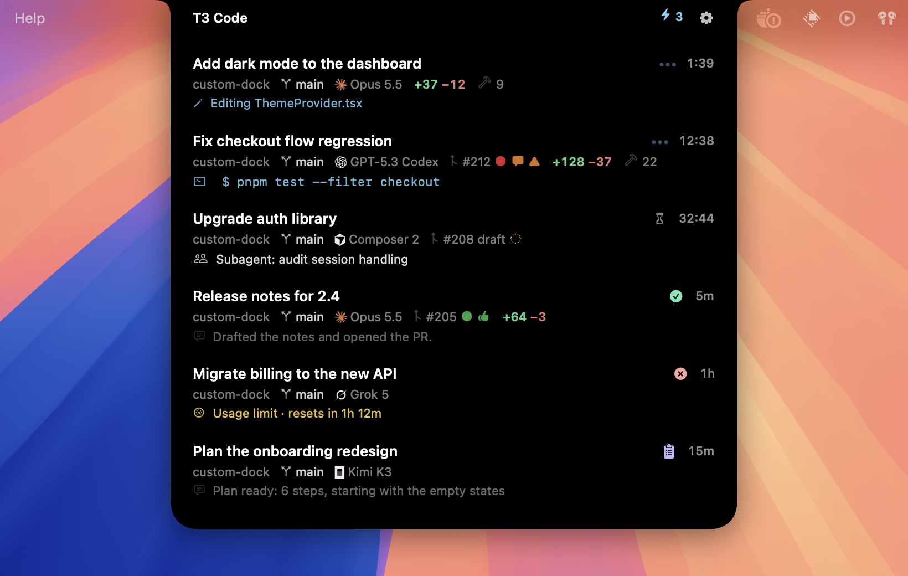
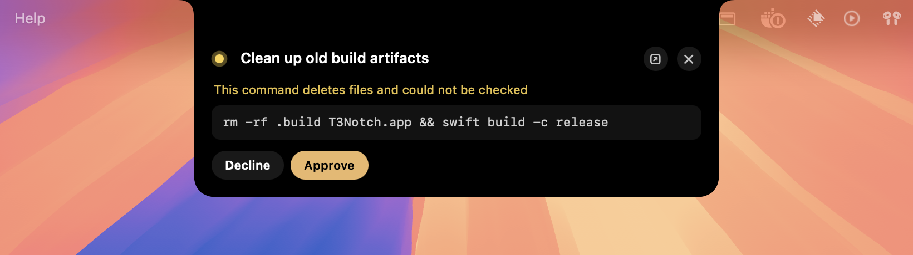
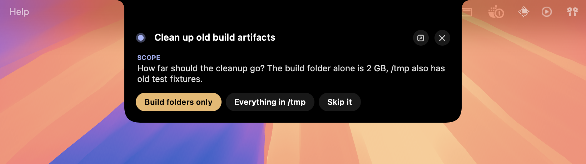
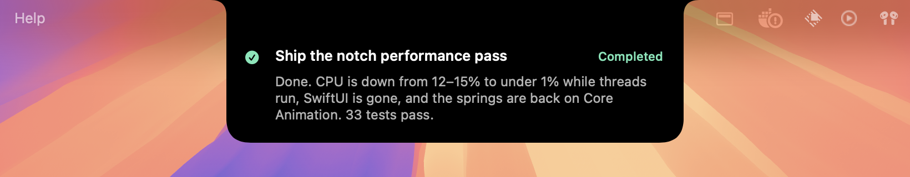

# t3code-notch

A Dynamic Island–style notch for [T3 Code](https://github.com/t3tools/t3code) on macOS. See what your agents are doing, answer them, and stop them, without leaving the app you're in.



Hover it (or press **⌘⇧Space**) for the full list:



When an agent needs you, answer right from the notch:

| Approvals | Questions |
|---|---|
|  |  |

And when a run finishes, its final message drops down for a few seconds:



## Features

- **Live compact bar:** the working thread's title, what it's doing (command, file edit, thinking), `+added −removed` lines and a timer. It rotates through working threads with a spring slide.
- **T3's own statuses:** Working, Connecting, Waiting, Pending Approval, Awaiting Input, Failed, Plan Ready, Completed. The logic is ported from T3's sidebar and covered by tests.
- **Act without switching apps:** approve or deny, tap an answer, reply or steer a running agent, or stop a run (two clicks).
- **Live terminal:** hover a running command to watch its last lines stream in.
- **At a glance:** branch, model with the provider's logo, PR number with CI checks / review / conflict markers, and a usage-limit countdown.
- **Keyboard:** ⌘⇧Space opens it; ↑↓ select, ⏎ open, R reply, A/D approve/deny, 1–9 answer, Esc close.
- **Cozy sounds:** a soft click when a run finishes, a tick-tock when an agent needs you.
- **Private by default:** invisible to screen sharing, recordings and screenshots (toggle in the menu).
- **Light on resources:** AppKit + Core Animation, no SwiftUI. Under 1% CPU while agents run, and no memory growth. [Performance notes](docs/performance.html).

## Requirements

- macOS 14 or later (built and tested on macOS 26)
- [T3 Code](https://github.com/t3tools/t3code) desktop app, running
- Xcode command-line tools (Swift 5.9+)

## Build and run

```sh
./build.sh          # builds T3Notch.app (signs with your "Apple Development" identity if present, else ad-hoc)
open T3Notch.app
swift test          # status, wire-format and diff-count tests
```

The menu-bar icon has the settings: which display(s) to show it on, sounds, screen-sharing visibility, model display, and Launch at Login.

## How it connects

- Finds the local T3 server through `~/.t3/userdata/server-runtime.json`, re-read on every reconnect, so a port change or restart is picked up automatically.
- On first launch it creates its own bearer token with T3's CLI (`~/.t3/bin/t3 auth session issue`, scopes `orchestration:read` + `orchestration:operate`, 30 days, label "T3 Notch"). The token is stored in `~/Library/Application Support/T3Notch/` with owner-only permissions, and re-issued if the server rejects it.
- Streams the thread list (`orchestration.subscribeShell`) and, for the visible threads only, their activity (`orchestration.subscribeThread`) over T3's WebSocket RPC (orchestration protocol 2). A newer protocol shows "Needs an update".
- Live `+/−` counts mid-run read only the patch of each file edit from T3's local database, read-only, because the server doesn't send it. The exact numbers arrive with the run's checkpoint either way.

## Development

| Variable | Effect |
|---|---|
| `T3NOTCH_DEMO=approval\|question\|finished\|list` | fake threads for layouts and screenshots |
| `T3NOTCH_ALLOW_CAPTURE=1` | let screenshots include the notch for this launch |
| `T3NOTCH_FORCE_EXPANDED=1` | keep the list open |
| `T3NOTCH_RUNTIME_FILE=path` | read the server address from another file |

- `scripts/screenshots.sh` regenerates `docs/screenshots/` (run it from an empty desktop).
- `scripts/extract-logos.py /path/to/t3code` refreshes the provider logos from T3 Code's sources.
- `scripts/make-icon.swift` regenerates the app icon.

Provider logos are the ones T3 Code ships and belong to their respective owners. This project isn't affiliated with T3 Tools.
